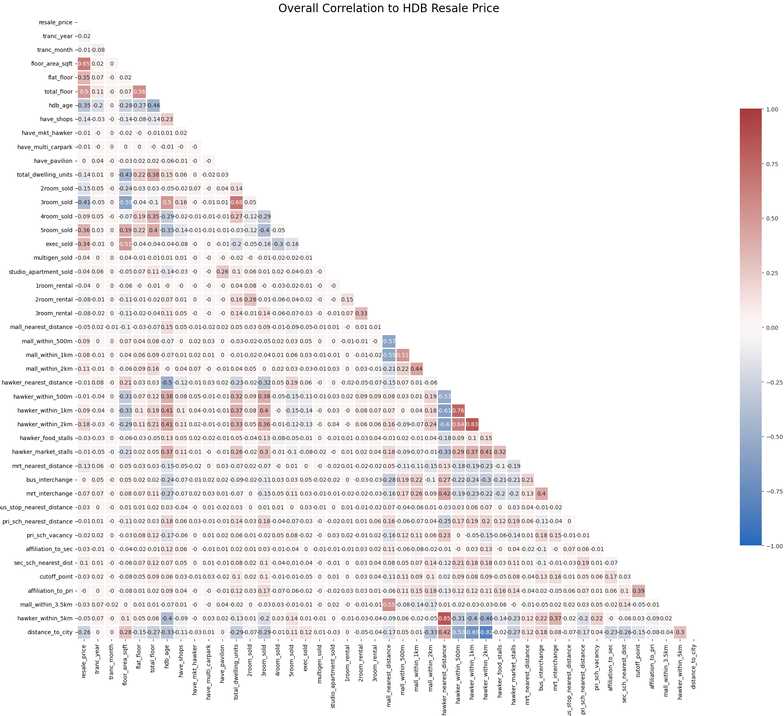
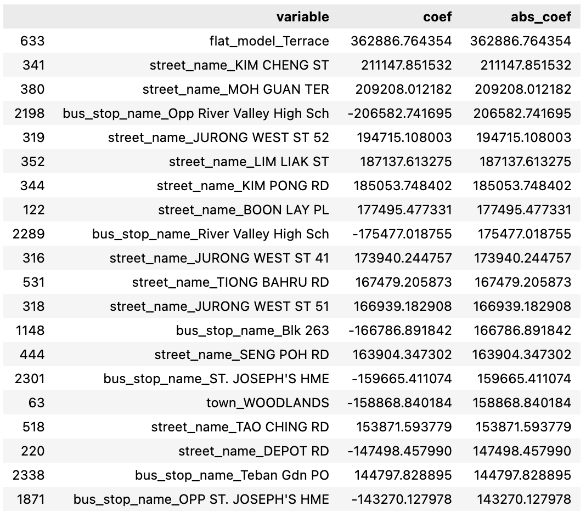
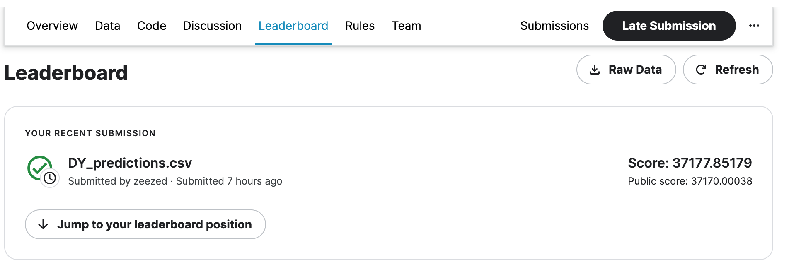

## Project 2: Predicting HDB Resale Prices

### Background

Housing is often the most significant purchase that people make in their lifetime and property prices are a key concern for many individuals and families. The cost of housing can have a major impact on people's financial well-being and can affect their ability to achieve other important goals, such as saving for retirement, sending children to college or starting a business. In recent years, the issue of home affordability has increasingly come under the spotlight as HDB resale prices have risen by [**31.9% over the last 12 quarters**](https://www.straitstimes.com/singapore/housing/hdb-resale-prices-rise-09-in-q1-smallest-increase-in-last-10-quarters).

This projects aims to help potential buyers to understand more about the key factors driving resale prices and also to derive a model based on these factors to provide HDB resale price prediction that can serve as a reference for potential buyers in making their flat purchase decision.

## Problem Statement

As a potential flat buyer, I would like to find out the **best price prediction model** that can be derived from a set of past HDB resale transaction data, so that I can use it as a guideline to understand the prices of different types of flats in different location. I would also be interested to know what are **the top factors that have significant influence on HDB resale flats.**, which will be very helpful to help me make a decision where to buy based on my needs and budget.

### Datasets

The datasets that will be used in this analysis are:

* `train.csv` downloaded from [Kaggle](https://www.kaggle.com/competitions/dsi-sg-project-2-regression-challenge-hdb-price/data) used for data cleaning and EDA;

* `hdb_modelling_2.csv` imported as cleaned data set to used for modelling;

> **Note:** the data files are not included in this repository because of their size (about 124 MB). To re-run the notebooks, download `train.csv` from the [Kaggle competition page](https://www.kaggle.com/competitions/dsi-sg-project-2-regression-challenge-hdb-price/data) into the `data/` folder. Notebook 1 creates `hdb_modelling_2.csv` for notebook 2.

## Approach

The steps taken to address the problem statement are as follows:

* Data import and cleaning

* EDA and Data Visualizations

* Model preparation

* Modelling

* Coefficient Analysis - the best performing model is used to derive coefficient of the features to analyze which ones have strong relationship to resale price

* Conclusion and Recommendations - Summarized findings to the problem statement and suggestions are made for future improvement

## Data Import and Cleaning

The following libraries are being imported for use in this project:
  - Pandas
  - Numpy
  - Matplotlib.pyplot
  - Seaborn
  - statsmodels.api

The data set is imported and the following data cleaning steps are carried out:
  - Check for missing values
  - Check for duplicates
  - Check for datatypes to find discrepancies
  - Check data columns for repetition and/or redundancy

The number of columns is reduced from 77 to 52 at this stage.

## Exploratory Data Analysis (EDA)

Investigate trends in the data and provide following observations:
  - Correlations among variables
  - Price trends over time
  - Price trends by various variables
  - Statistical significance of variables to resale price

## Data Visualizations

The following charts are plotted to better visualize the data trends and correlations:
  **Correlation Heatmap**

  

**Price Trends**

 

 

 

 

 

### Model preparation

- Cleaned data is imported into the modelling notebook
- Preprocess data using train_test_split and further grouped into numerical and categorical sets for scaling by using One Hot Encoder and Standard Scaler

## Modelling

Linear Regression model is used to derive a baseline model before using Ridge and Lasso to determine the best performing model.

| Model           | Linear    | Ridge   | Lasso   |
| --------------- | --------- | ------- | ------- |
| R2 Train Score  | 0.93557   | 0.93555 | 0.90038 |
| R2 Test Score   | 0.93169   | 0.93173 | 0.89984 |
| Cross Val Score |  -3.5E+15 | 0.93196 | 0.89995 |
| RMSE Train      | 36421.4   | 36426.5 | 45289.3 |
| RMSE Test       | 36421.4   | 36426.5 | 45289.3 |

Ridge has the best performance among the 3 models.

## Conclusion and Recommendations

Top 20 variables coefficients using Ridge:

**Findings**
* As indicated above, the majority of the most significant features that have strong relationship with resale prices are mostly rare HDB flat type (two-storey terrace built in the 50s) and location related.
* Inferring from majority of the street names coefficients, flats located in **Tiong Bahru** are likely the most expensive due to its prime location (proximity to city, well-established amenities, travel convenience).
* Inferring from coefficients of Jurong West St 52/St 51/St 41, flats located **near to popular primary schools** (see map screenshot below). Rulang Primary School is known to be the top school in Jurong are also likely to be popular and hence cost more.

* Inferring from coefficient of Tao Ching Road, flats near to **multiple good amenities** can be a key factor influencing price as well. Looking at a snapshot of its location on Google Map, flats located at this area are next to a huge garden and near to supermarket (NTUC) as well as hawker centre (Taman Jurong Food Centre).

* Flats located in **Woodlands** relatively cost less due to its far north location and can be an option for buyers with tight budget.

**Summary**
* Best model to use for predicting resale prices = Ridge
* Key factors that have major influence on price = location, maturity and variety of amenities, schooling
* Valuable flat type is HDB Terrace and popular locations are Tiong Bahru and Jurong
* Woodlands can be a good option if one has tight budget

**Recommendations for Future Improvement**
* More research and analysis can be made to identify more accurately what features can be further eliminated to improve the model performance.
* As many categorical features are non-quantitative in nature and may not have linear relationship with price, it might make more sense to use other more suitable models such as Random forest or Neural networks that can learn non-linear patterns better.

### Kaggle Competition Submission

