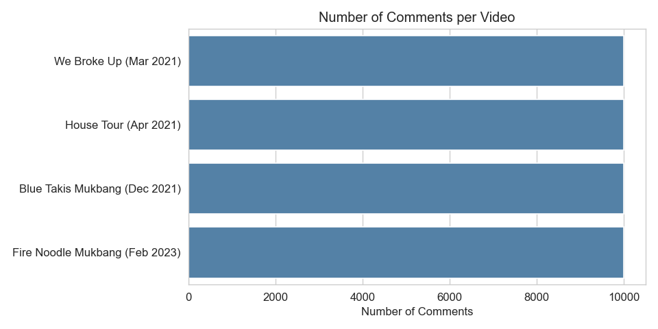
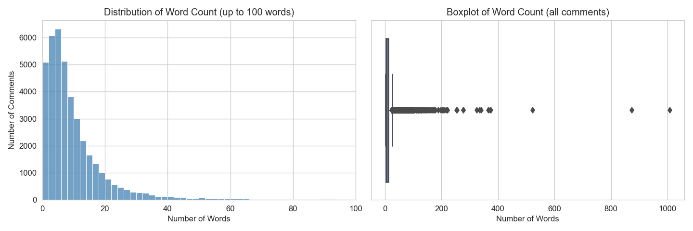
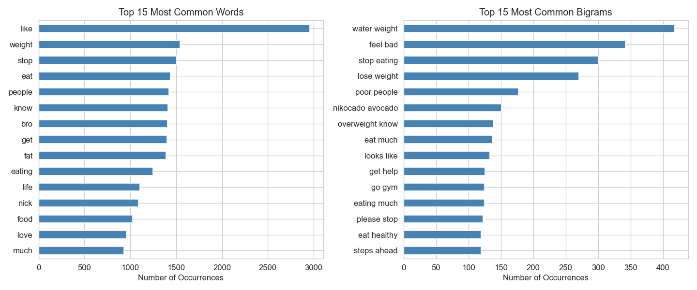
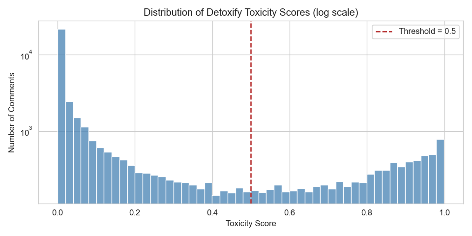
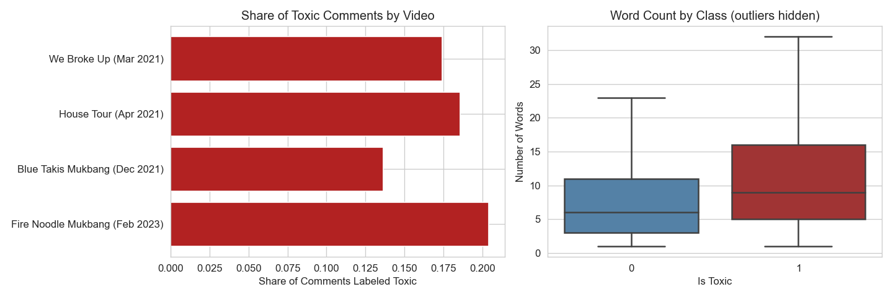
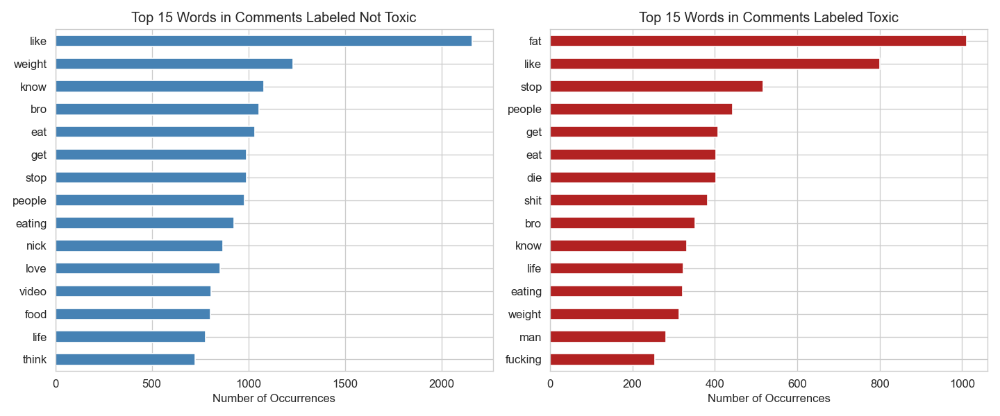
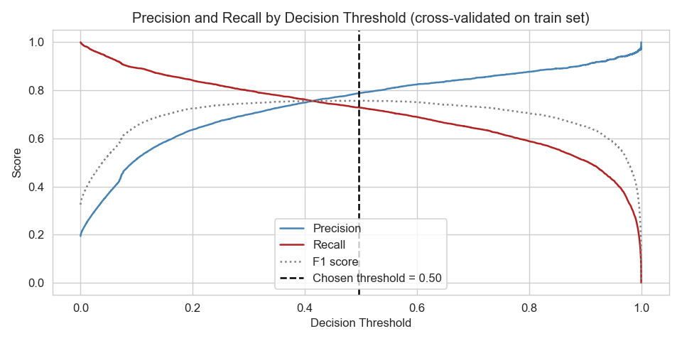
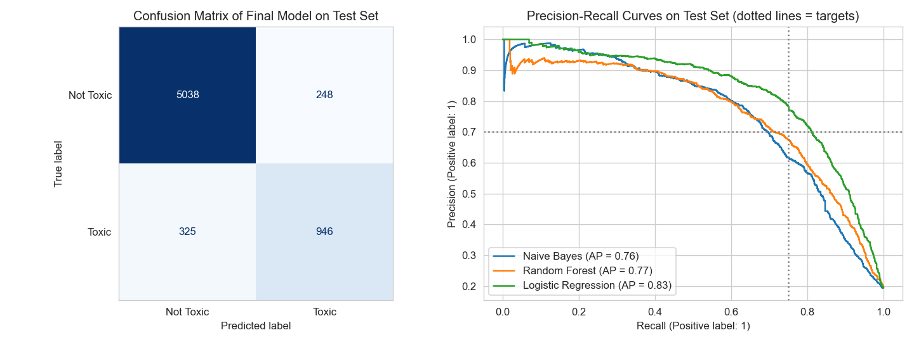
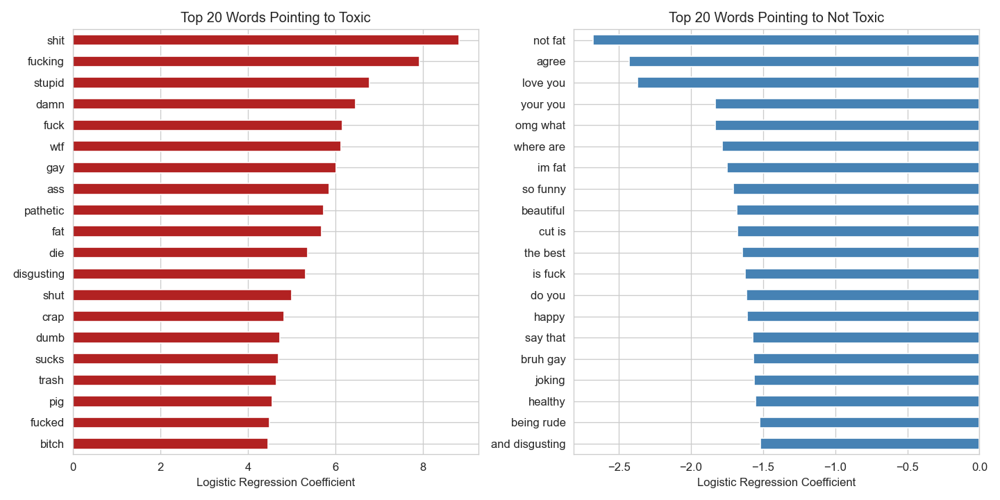

# Project 3: Toxic Comment Detection on YouTube

## Executive Summary

A YouTube channel's community team wants toxic comments to be held automatically for review, instead of having moderators read every comment. This project collects 40,000 comments from four videos through the YouTube Data API, labels them with the open-source Detoxify model, and trains classification models to predict whether a comment is toxic from its text.

**Logistic Regression** on word and bigram counts was the best of three models compared. Against the Detoxify labels of a test set of 6,557 comments, **79% of the comments it flags are toxic (precision)**, meeting the target of 70%, and it **catches 74% of toxic comments (recall)**, narrowly missing the target of 75%. A baseline that predicts the majority class catches none.

However, a check against **300 comments labeled by hand** shows that the Detoxify labels agree only fairly with human judgement (Cohen's kappa of 0.22). Detoxify reacts mainly to offensive words, while much of the hostility on this channel is mockery that uses none. The model reproduces Detoxify's labels, so it inherits this gap. **The model is not recommended for moderation yet.** The next step is to label comments by hand using a definition agreed with the community team, and retrain the same pipeline on those labels.

## Contents

| Notebook | Description |
| --- | --- |
| [01_data_extraction](code/01_data_extraction.ipynb) | Extract comments from the YouTube Data API |
| [02_cleaning_eda_labelling](code/02_cleaning_eda_labelling.ipynb) | Data cleaning, EDA, labelling with Detoxify, text preprocessing |
| [03_modelling](code/03_modelling.ipynb) | Baseline, model comparison and tuning, evaluation, conclusion |

```
03_Toxic-Comment-Detection
├── README.md
├── code                          the three notebooks
├── data
│   ├── raw                       not included (see note below)
│   ├── detoxify_scores.csv       toxicity score of each comment
│   ├── comments_labelled.csv     cleaned and labeled comments used for modelling
│   └── gold_sample.csv           300 comments labeled by hand, to check the Detoxify labels
└── images                        charts used in this README
```

> **Note:** the raw comment files (`data/raw/`) are not included, because they contain commenters' names and channel links, and YouTube's API terms do not allow sharing them. Notebook 01 rebuilds them with your own YouTube Data API key. The cleaned and labelled comments, which have no names, are included, so notebooks 02 and 03 can be run from there.


---

# 1. Problem Statement

Online toxicity in the form of harassment and abuse is a major concern on social media. A [study](https://www.pewresearch.org/internet/2021/01/13/the-state-of-online-harassment/) by the Pew Research Center found that 41% of Americans have experienced online harassment. For a YouTube channel, toxic comments harm the creator and drive other viewers away from the discussion, but a popular video can receive tens of thousands of comments, far more than a moderator can read.

**Goal:** build a classification model that predicts whether a YouTube comment is toxic (1) or not toxic (0) from its text, so that toxic comments can be held automatically for review by a moderator.

**Stakeholders:** the primary stakeholder is the channel's community team (moderators). Secondary stakeholders are the creator and the viewers, who benefit from a safer comment section, and viewers whose harmless comments should not be held back unnecessarily.

**Measure of success** on the toxic class of a test set that is not used for training or tuning:

| Metric | Target | Why |
| --- | --- | --- |
| Recall | at least 0.75 | At least three in four toxic comments are caught |
| Precision | at least 0.70 | At least seven in ten flagged comments are indeed toxic, so that moderators' time is not wasted |
| F1 score | better than baseline | Combines the two, and is used to compare models |

Accuracy is not used to compare models because the classes are imbalanced.

# 2. Data Collection

Comments were extracted on 14 October 2026 with the [YouTube Data API v3](https://developers.google.com/youtube/v3/docs/commentThreads/list) from four videos by [Nikocado Avocado](https://www.youtube.com/user/nikocadoavocado), a mukbang creator whose videos attract a large volume of comments, many of them hostile.

| Video | Published | Comments collected | Period covered |
| --- | --- | --- | --- |
| We Broke Up | Mar 2021 | 10,000 | Mar 2021 to Oct 2026 |
| MY NEW HOUSE TOUR – I bought a $2,300,000 Million Dollar Penthouse | Apr 2021 | 10,000 | Apr 2021 to Sep 2026 |
| EXTREME BLUE TAKIS FIRE NOODLES WITH HUNGRY FAT CHICK • Mukbang & Recipe | Dec 2021 | 10,000 | Feb 2023 to Oct 2026 |
| EXTREME FIRE NOODLE CHALLENGE WITH HUNGRY FAT CHICK • Mukbang & Recipe | Feb 2023 | 10,000 | Feb 2023 to Sep 2026 |
| **Total** | | **40,000** | |

* The extraction is automated with custom functions that request the maximum of 100 comment threads per call, pause between requests, and skip videos that have already been extracted.
* The extraction is limited to 10,000 comments per video, so that no single video dominates the data, and to 1,000 API requests in total, to stay within the quota. It used 269 requests.
* The API returns comments newest first, so for the Blue Takis mukbang the comments from the first year after its release are not included.
* The API key is read from an environment variable and is not stored in the notebook.



# 3. Data Cleaning and EDA

**Cleaning**

* All values were confirmed to be in their correct columns, and every reply's top-level comment is in the data.
* 7 comments with no text were dropped. No comment was extracted twice.
* 20 comments with more than 200 words were dropped as outliers. Half of them are spam made up of the same few words repeated many times, and the rest are mostly long copied texts.

**Findings**

* Comments are short: half of them have 6 words or fewer, and 99% have 57 words or fewer.



* The most common words and bigrams are about eating, weight and health, and appeals to the creator ('please stop', 'get help'). The most common bigram, 'water weight', is the creator's own catchphrase.



# 4. Labelling with Detoxify

The comments do not come with labels. They were labeled with [Detoxify](https://github.com/unitaryai/detoxify), an open-source BERT model trained on about 160,000 Wikipedia comments which were labeled by human raters for the Jigsaw Toxic Comment Classification Challenge. It replaces Google's Perspective API, which will be shut down on 31 December 2026.

* Detoxify runs locally with no API key, request limit or cost. All 39,973 comments were scored in 2.7 minutes, and the labels can be reproduced by anyone.
* The original text of each comment is scored, not the cleaned text, as the model makes use of casing, punctuation and word order.
* A comment is labeled toxic if its toxicity score is 0.5 or above. The scores are concentrated at the two ends (about 69% below 0.1 and 13% above 0.7), so the labels are not very sensitive to the exact threshold.
* From a sample, the scores are generally sensible, but blunt expressions of concern ('ur killing yourself'), viewers calling out others for being cruel, and profanities not aimed at anyone also receive high scores.



* 17.5% of comments are labeled toxic, ranging from 13.6% to 20.4% across the four videos. Toxic comments tend to be longer, and top-level comments are more often toxic (19.1%) than replies (14.5%).



* The words that are distinctive of toxic comments are 'fat' (the most common word in toxic comments), 'die' and profanities, while many topic words ('like', 'stop', 'eat', 'weight') are common in both classes.



# 5. Preprocessing

Four versions of the text were prepared so that the effect of each step can be compared:

| Version | Processing |
| --- | --- |
| Cleaned only | Lowercase; remove URLs, mentions, emojis, numbers and punctuation; shorten repeated letters |
| Stop words removed | Cleaned text with stop words removed |
| Stemmed | Stop words removed, then stemmed (Porter stemmer) |
| Lemmatized | Stop words removed, then lemmatized (WordNet lemmatizer) |

* 2,351 comments with no text left after cleaning (only emojis, timestamps or non-latin scripts) were dropped.
* 4,839 comments whose cleaned text is the same as an earlier comment were dropped, so that the same text cannot be in both the train and test sets.
* **32,783 unique comments remain for modelling, of which 19.4% are toxic.**

# 6. Modelling

The data was split into a train set (80%) and a test set (20%), stratified by class. All comparisons and tuning were done with 5-fold cross-validation on the train set, and the test set was used only once at the end.

> ## Baseline

Predicting the majority class (not toxic) for every comment gives an accuracy of 80.6%, but recall, precision and F1 score of 0 on the toxic class, as it does not catch any toxic comment.

> ## Comparing preprocessing methods

| Mean CV F1 score | Naive Bayes + CountVectorizer | Logistic Regression + CountVectorizer | Naive Bayes + TF-IDF | Logistic Regression + TF-IDF |
| --- | --- | --- | --- | --- |
| Cleaned only | **0.6220** | **0.7221** | 0.2000 | **0.6584** |
| Stop words removed | 0.6073 | 0.6952 | 0.2843 | 0.6251 |
| Stop words removed + stemmed | 0.6165 | 0.6990 | 0.2959 | 0.6386 |
| Stop words removed + lemmatized | 0.6136 | 0.6978 | 0.2954 | 0.6355 |

* Removing stop words made the models worse in three of the four combinations. Stop words include 'you', 'your' and 'are', which indicate that a comment is aimed at someone.
* Stemming and lemmatization made little difference.
* The cleaned text with stop words kept was used for the rest of the modelling.

> ## Tuning and comparing models

Each model was tuned together with its vectorizer in a pipeline using GridSearchCV.

| Model | Best parameters | Train F1 | CV F1 | CV Precision | CV Recall |
| --- | --- | --- | --- | --- | --- |
| Naive Bayes | CountVectorizer (min_df=5, unigrams), alpha=0.5 | 0.7722 | 0.7029 | 0.8007 | 0.6265 |
| Random Forest | TF-IDF (max_features=5000), class_weight='balanced', min_samples_leaf=2 | 0.8845 | 0.7071 | 0.7024 | 0.7118 |
| Logistic Regression | CountVectorizer (unigrams + bigrams), C=3, class_weight='balanced' | 0.9933 | **0.7572** | 0.7891 | 0.7278 |

* **Logistic Regression was selected as the production model.** It has the highest cross-validated F1 score and the highest recall, and its weights are easy to explain. None of the models reached the recall target of 0.75 in cross-validation at the default threshold.
* Naive Bayes overfits the least and is the fastest, but misses more than a third of the toxic comments.
* Random Forest has a similar F1 score to Naive Bayes with higher recall and the lowest precision, and is the slowest to train.
* Logistic Regression has the largest gap between train and cross-validated scores, as it has over 100,000 word and bigram features. It was selected on the cross-validated score, which measures performance on comments it was not trained on.

> ## Decision threshold

The threshold for flagging a comment was chosen in advance to maximise the F1 score, using cross-validated predictions on the train set. This gives 0.496, practically the default of 0.5. The chart shows the trade-off: in cross-validation, recall reaches 0.75 at a threshold of about 0.43, where precision falls to about 0.76.



# 7. Evaluation

**Final model on the test set of 6,557 comments:**

| Metric (toxic class) | Target | Baseline | Final model | Met? |
| --- | --- | --- | --- | --- |
| Recall | at least 0.75 | 0 | **0.74** | No, narrowly missed |
| Precision | at least 0.70 | 0 | **0.79** | Yes |
| F1 score | above baseline | 0 | **0.77** | Yes |
| Accuracy (all comments) | | 0.81 | 0.91 | |



* **The precision target is met, but the recall target is narrowly missed** (0.744 against 0.75). The test F1 score (0.768) is in line with the cross-validated score (0.757).
* Moderators would review 1,194 flagged comments instead of all 6,557 (a reduction of 82%). 325 toxic comments (about 1 in 4) would slip through, and 248 harmless comments would be held for review.
* Logistic Regression is the best of the three models on every metric on the test set.
* The F1 score ranges from 0.73 to 0.81 across the four videos, with recall lowest for *We Broke Up* and the *Blue Takis Mukbang* (about 0.70).

**What the model has learned**



* Words pointing to toxic are profanities and slurs, insults ('stupid', 'pathetic', 'dumb', 'disgusting', 'pig'), 'fat', and words about death. Words pointing to not toxic are words of appreciation and agreement.
* Bigrams add context: 'not fat' is the strongest non-toxic feature, softening a word that is otherwise toxic.

**Error analysis**

* Comments with a borderline Detoxify score (0.3 to 0.7) make up 10.5% of the test set but 48% of the errors. For these, the label itself is uncertain.
* The model misses mockery that has no obviously toxic word, and flags harmless uses of trigger words, such as viewers defending the creator. A model based on word counts cannot tell tone from vocabulary.
* Some errors are in the labels themselves: for example, Detoxify gave a high toxicity score to a comment simply mentioning a person's race.

**Check against manual labels**

The test scores above measure agreement with the Detoxify labels. To check the labels themselves, 300 comments (50 from each range of Detoxify score) were labeled by hand by one person, and 107 of them were labeled toxic.

| Compared with the manual labels | Comments | Agreement | Precision | Recall | Cohen's kappa |
| --- | --- | --- | --- | --- | --- |
| Detoxify labels (all labeled comments) | 300 | 0.61 | 0.47 | 0.65 | 0.22 |
| Detoxify labels (test set only) | 51 | 0.61 | 0.38 | 0.71 | 0.22 |
| Final model (test set only) | 51 | 0.65 | 0.42 | 0.71 | 0.28 |

* **The Detoxify labels agree only fairly with the manual labels** (kappa of 0.22). Weighting the sample to reflect all comments gives rough estimates of precision of about 0.48 and recall of about 0.39 for the Detoxify labels: only about half of the comments Detoxify labels toxic are toxic by the manual labels, and it labels only about 4 in 10 of the comments that are.
* **The two use different definitions.** Detoxify labels casual profanity as toxic ('Wtf is this?'), while the manual labels count mockery and veiled hostility without offensive words as toxic ('Don't worry he won't be here for long' has a Detoxify score of 0.00).
* **The final model does no better than Detoxify against the manual labels.** It was only compared on the 51 labeled comments in the test set, as it reproduces the Detoxify labels of the comments it was trained on almost exactly (99.2%). With 14 toxic comments among them, the small difference from Detoxify is not meaningful.
* These findings are based on one person's labels and a small sample, so they need to be confirmed with labels from several people.

# 8. Conclusion and Recommendations

The goal was to build a model that predicts whether a YouTube comment is toxic, so that toxic comments can be held for review. The final Logistic Regression model reproduces the Detoxify labels well, meeting the precision target (0.79) and narrowly missing the recall target (0.74 against 0.75). However, the Detoxify labels agree only fairly with human judgement, so the model cannot yet be relied on to find what moderators would consider toxic. **The problem statement is therefore only partly answered:** a simple, fast model can reproduce a toxicity labeller closely, but it needs labels that reflect the team's own judgement.

**Recommendations for the community team**

* **Do not rely on the model for moderation yet.** Its precision and recall against the team's own judgement are likely to be well below the targets.
* **Agree on a written definition of toxic and label comments by hand.** The definition should say whether, for example, casual profanity and mockery of the creator count as toxic. A few thousand comments labeled by two or more moderators would be enough to retrain and evaluate the same pipeline. The 300 comments labeled for this project are a starting point.
* **Set the decision threshold on the manual labels.** The threshold of about 0.43 that meets the recall target on the Detoxify labels is unlikely to carry over.
* **If the model is used in the meantime, use it only to hold comments for review, never to delete them.** It will mostly flag comments with offensive words, including harmless profanity, and miss mockery, so viewer reports remain essential.
* The pipeline is cheap to reuse: the model trains in about a second and scores comments without a GPU, so it can be retrained easily as manual labels are added.

**Limitations**

* **The labels come from a model, and agree only fairly with human judgement.** The model's scores measure how well it reproduces Detoxify, which misses much of the mockery on this channel, flags harmless profanity, and scores some identity terms as toxic.
* **The manual check is small.** It is based on 300 comments labeled by one person, and only 51 of them are in the test set.
* **One creator only.** The vocabulary is specific to this channel (food, weight, health), so the model may not perform as well on other channels.
* **Tone and context.** The model relies on words and pairs of words, so it misses mockery and misspelt insults.
* **Data coverage.** Only the 10,000 most recent comments of each video were collected, at most 5 replies per thread, and comments with only emojis or non-latin scripts cannot be classified.
* **Overfitting.** The final model fits the train set much better than unseen data (F1 score of 0.99 against 0.76), although its score on unseen data was the best and was confirmed on the test set.

**Next steps**

1. Agree on a definition of toxic with the community team, label a few thousand comments by hand with at least two people per comment, and measure their agreement with each other.
2. Retrain and evaluate the models on the manual labels, and choose the decision threshold on them.
3. Compare other labellers against the manual labels, e.g. Detoxify's `unbiased` model or a large language model given the team's definition, to see if any of them could label comments more cheaply with acceptable agreement.
4. Add videos from other creators to test how well the model generalises.
5. Try features that capture more context, such as character n-grams for misspellings, emojis, or a fine-tuned pre-trained language model, which is better able to recognise mockery that uses no offensive words.
