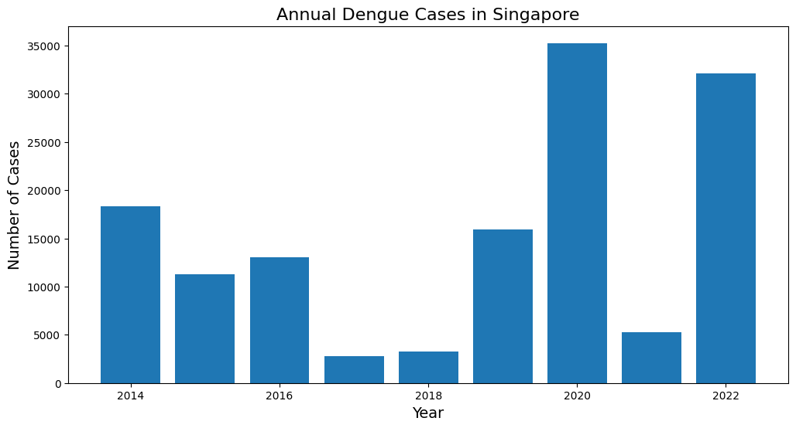
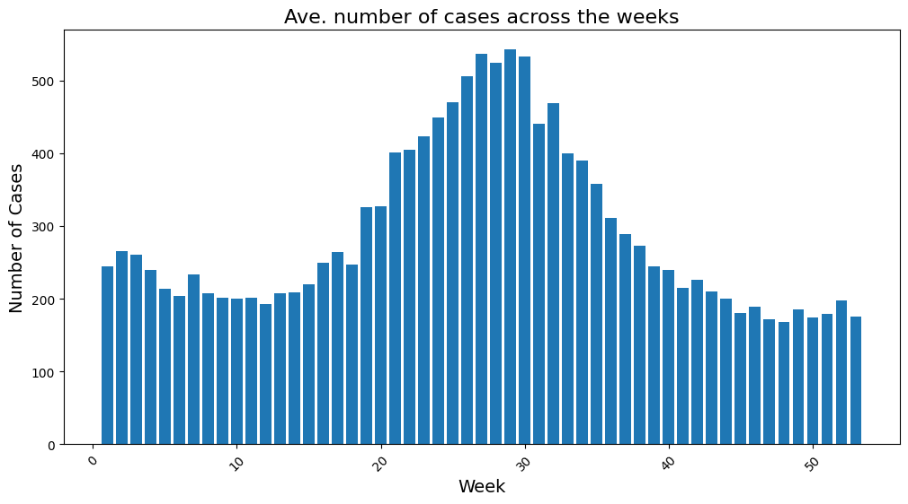
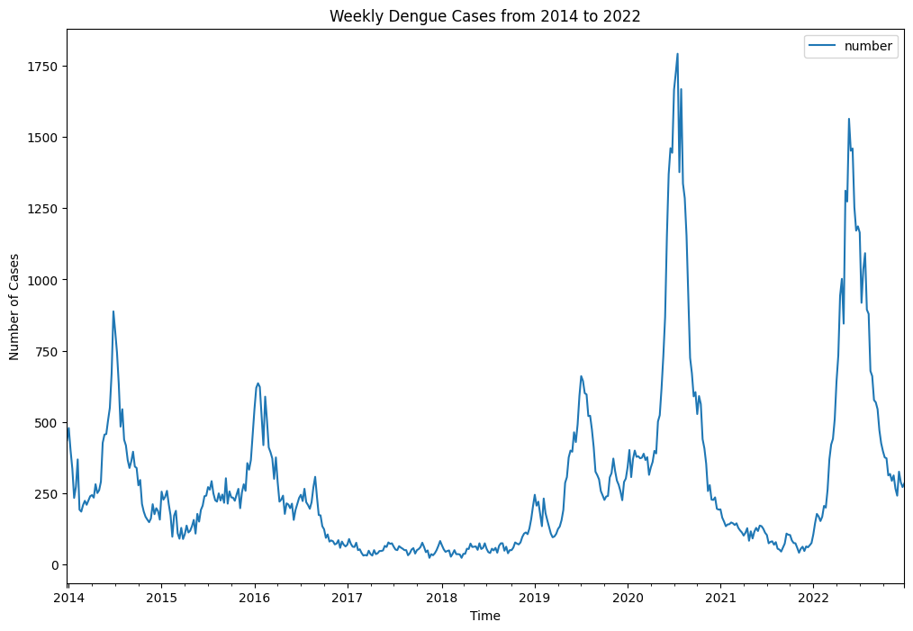
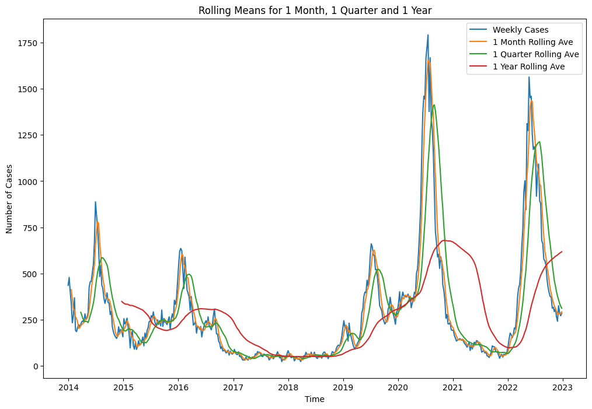
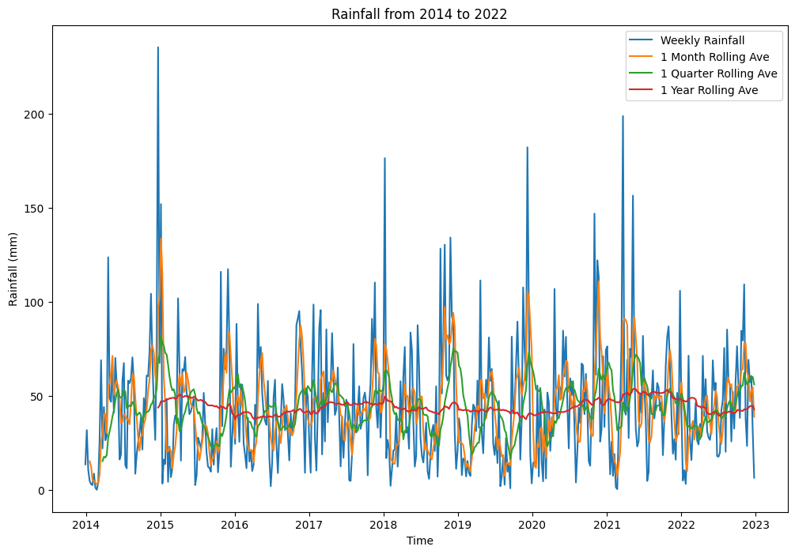
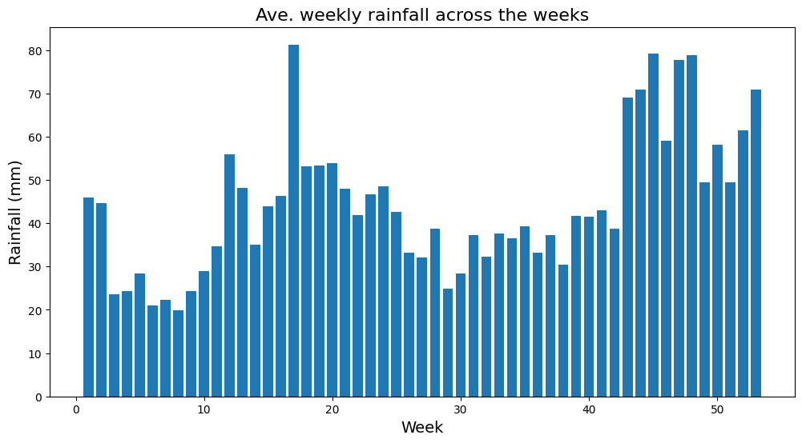
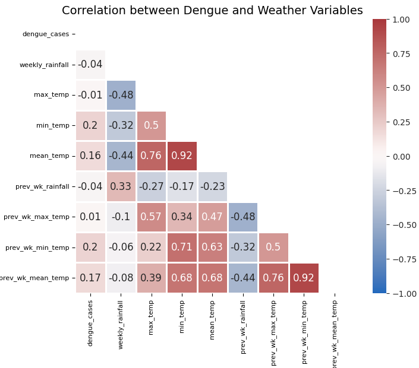
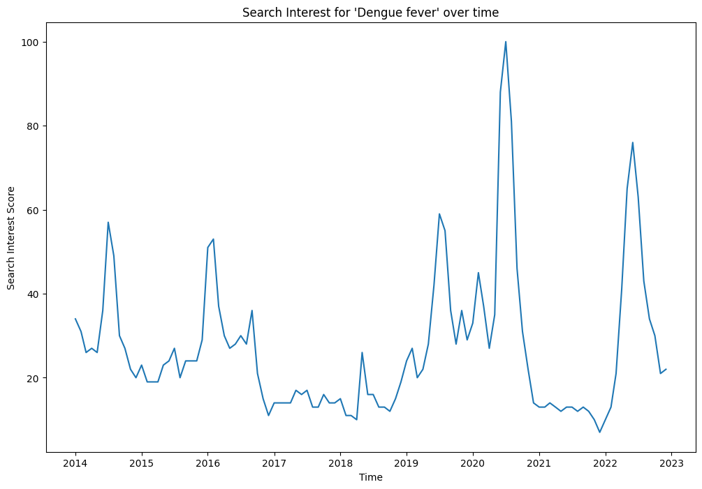
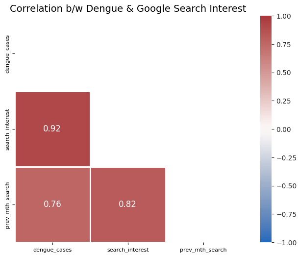

# Project 4: Predicting Dengue Cases 

> **Group project:** done in a team of two for the General Assembly Data Science Immersive. This folder contains my notebooks and analysis.

**Data:** the raw source files (data.gov.sg, Open-Meteo, Google Trends) are in `assets/`. Notebook 01 reads them and saves the cleaned files to `data/` for notebook 02.

**This project comprised of 3 notebooks** 
* Notebook 01: Data Cleaning, EDA, Preprocessing 
* Notebook 02: Modelling
* Notebook 03: Cost Benefit Analysis & Conclusion

# Executive Summary 

The effective management of dengue cases has always been a top priority for the National Environment Agency (NEA). In this exercise, the aim is to develop a time series forecasting model with a Mean Absolute Percentage Error (MAPE) target of 0.10 or less to predict dengue cases in Singapore for a time horizon between 3 months and 1 year. This would allow NEA to efficiently plan and allocate manpower resources dedicated to outreach initiatives to prevent and control dengue cases. Data on dengue cases, weather and Google search interest trends are first downloaded and compiled into .csv files. Data cleaning and exploration are then conducted to derive findings to determine the appropriate preprocessing and modelling approaches. No apparent regular pattern is observed in the number of dengue cases between 2014 and 2022 due to a variety of factors and event occurrences such as the COVID-19 pandemic. Rainfall and temperatures are found to have weak correlation to dengue cases whereas Google search interest presented strong correlations. Suitability of these variables to be used in the modelling is also discussed. The best performing model derived is a ARIMA model that omitted the outlier 2020 period with a MAPE of 0.10. Based on prediction using the model, a 25.52% decrease in dengue cases can be expected for a 6 months horizon. The manpower cost related to outreach efforts to control and prevent Dengue is estimated to be $2,775,629 per half year. A 15% manpower reduction is proposed to buffer for ~10% margin of error in prediction as well as to account for any unforeseen circumstances that may cause a spike in dengue cases, which translates into a cost savings of $416,344 per half year.  Based on findings through research and data exploration, there could be multiple simultaneous factors that have an impact on the number of dengue cases. As such, weather data and/or search trend data alone is not sufficient to explain for the number of dengue cases. For future improvement, considerations can be put on factors such as the number and distribution of Aedes mosquito breeding habitats, the type of dominant Dengue virus serotype, human population density of the area with high breeding habitats, lifestyle habits of the residents in that area, and the geographical characteristic of that area.

# Problem Statement 
### Background
Dengue case is a major focus area for the National Environment Agency (NEA) to tackle as it is a significant public health concern in Singapore. Last year, there were [32,173 dengue cases recorded, which was six times the total number of cases in 2021](https://www.nea.gov.sg/media/news/news/index/nea-launches-national-dengue-prevention-campaign-early-urge-vigilance-avert-dengue-outbreak-2023#:~:text=7%20A%20total%20of%2032%2C173,in%20the%20whole%20of%202021.). The number of dengue cases is expected to remain high or increase in the current year of 2023. Hence, it is useful for NEA to be able to predict on the number of dengue cases as accurately as possible in order to proactively allocate resources, implement preventive measures, and raise public awareness to mitigate the spread of Dengue fever.

### Objective and Scope

The goal of this exercise is to develop a predictive model to forecast dengue cases in Singapore for a time horizon range between 3 months and 1 year that NEA can utilize to plan and allocate outreach manpower resources in a cost-efficient manner.

The type of model that will be developed is a time series forecasting model. Success will be evaluated based on the Mean Absolute Percentage Error (MAPE) of the model with a target of 0.10 or less.

Lastly, the best performing model will be used as a basis for the cost-benefit analysis to derive the potential savings or other benefits that NEA can expect to achieve.

# The Approach
The following steps are taken to address the problem statement:

1.	**Data Compilation** – downloaded the various datasets from the respective sources mentioned above and compiled into csv files.
2.	**Data Cleaning, EDA and Pre-processing** – checked, cleaned, explored data to derive insights for data preprocessing and modelling approach.
3.	**Modelling** – Developed, tuned and evaluated ARIMA, SARIMA, and ARIMAX models to determine the best performing model.
4.	**Cost Benefit Analysis and Conclusion** – Analyzed potential cost savings based on results from the best performing model and discussed limitations as well as future improvements.

# 1. Data Compilation
The data compiled from online sources and utilized included: 
* Dengue cases between 2014 and 2022 taken from [data.gov.sg](https://data.gov.sg/dataset/weekly-number-of-dengue-and-dengue-haemorrhagic-fever-cases) and [Weekly Infectious Bulletins](https://www.moh.gov.sg/resources-statistics) available at Singapore's Ministry of Health website. 
* External variables such as [weather information](https://open-meteo.com/en/docs/historical-weather-api), and [Google search interest](https://trends.google.com/trends/explore?date=2014-01-01%202022-12-31&geo=SG&q=%2Fm%2F09wsg) to explore the feasibility of leveraging them as predictors to forecast Dengue cases.

# 2. Data Cleaning, EDA and Pre-processing 
* Checked shape, duplicates, missing values, data types and researched on data definitions to determine the cleaning and/or preprocessing steps required.
* Ensured that the data is in the right datetime format for analysis.

* Explored data and derive findings on:
    * Dengue cases data
    * Weather data
    * Google search interest data

> ## Findings from Dengue Cases Data

  
  

  
  

   
* Mid-year period (June/July) was typically the peak period for dengue cases possibly due to higher temperature which [facilitated breeding and hatch rates of Aedes mosquitoes](https://www.nea.gov.sg/media/news/news/index/nea-urges-continued-vigilance-as-aedes-aegypti-mosquito-population-and-number-of-dengue-cases-remain-high-at-the-start-of-2020). However, the pattern across 2014 to 2022 was rather erratic.
* Lowest number of dengue casese was recorded in 2017 (2,772 dengue cases), [which was the lowest figure in the last 16 years](https://www.straitstimes.com/singapore/2772-dengue-cases-in-2017-the-lowest-in-the-last-16-years-nea) due to immunity buildup among the population and concerted efforts to control the situation.
* The highest number of weekly cases took place in 2020 (35,315). This was likely due to more people staying at home during the COVID-19 pandemic, which was [more conducive for the transmission of Dengue virus](https://www.channelnewsasia.com/commentary/why-singapore-record-high-dengue-cases-covid-19-2020-coronavirus-687281).
* The number of cases dipped significantly in the subsequent year 2021 possibly because of [reduced priority in dengue monitoring, under-detection & under-reporting of cases](https://www.channelnewsasia.com/asia/dengue-fever-plummet-southeast-asia-2021-covid-19-lockdown-1949581) attributed by the COVID-19 pandemic.
* The number of cases [soared again in the following year 2022](https://www.straitstimes.com/singapore/health/number-of-dengue-cases-in-2022-likely-to-be-second-highest-on-record) to 32,173, attributed to lower immunity against dominant DenV-3 virus strain, increased construction work leading to more mosquito breeding sites and warmer climate conditions which shortened the incubation cycle of Aedes mosquitoes.

> ## Findings from Exogenous Variables Data
### Weather

  
  

  

* In general, there is more rainfall towards the end of the year (October to December) and less rainfall in the middle of the year (June to August).
* This trend seemed to contradict with the understanding that more rainfall would lead to more mosquito breeding and hence more dengue cases. 
* No strong correlation between dengue and weather variables was observed, although temperatures were slightly more correlated with dengue cases, which was in line with the understanding that higher temperatures might contribute to higher dengue cases.

### Google Search Interest

  
  

* The 'dengue' search term and number of dengue cases were strongly correlated as Google search interest is understood to be an indicator of current hot trend. Interestingly however, the correlation of previous month's search interest for 'dengue' to dengue cases is also relatively high at 0.76. 
 
# 3. Modelling    
|                          | Baseline ARIMA              | ARIMA 1                                      | ARIMA 2 (Best)                                                      | ARIMA 3                                                     | SARIMA                                                              | ARIMAX                                                                                                       |
| ------------------------ | --------------------------- | -------------------------------------------- | ------------------------------------------------------------------- | ----------------------------------------------------------- | ------------------------------------------------------------------- | ------------------------------------------------------------------------------------------------------------ |
| Model                    | ARIMA                       | ARIMA                                        | ARIMA                                                               | ARIMA                                                       | SARIMA                                                              | ARIMAX                                                                                                       |
| Best Parameters Returned | p,d,q = (2,0,2)             | p,d,q = (2,1,1)                              | p,d,q = (3,0,1)                                                     | p,d,q = (2,1,1)                                             | p,d,q = (3,0,1) P,D,Q = (0,0,0)                                  | p,d,q = (2,0,0)                                                                                              |
| Train Size               | weekly cases from 2014-2021 | weekly cases from 2014 to first half of 2022 | weekly cases from 2014 to first half of 2022 (outlier 2020 omitted) | weekly cases from 2014 to Q3 of 2022 (outlier 2020 omitted) | weekly cases from 2014 to first half of 2022 (outlier 2020 omitted) | monthly cases from 2014 to first half of 2022 (outlier 2020 omitted) and prev month's google search interest |
| Test Size                | 2022                        | second half of 2022                          | second half of 2022                                                 | last quarter of 2022                                        | second half of 2022                                                 | second half of 2022                                                                                          |
| MAPE                     | 0.48                        | 1.48                                         | 0.10                                                                | 0.11                                                        | 0.10                                                                | 0.13                                                                                                         |

* The model to be used for the cost benefit analysis is the **ARIMA 2 model** as it has the lowest MAPE score of 0.10, which has met the target stipulated in the problem statement.
  
* A prediction period of 6 months/26 weeks is also an appropriate time frame for NEA to plan and allocate resources for the prevention and control of dengue cases.

# 4. Cost Benefit Analysis and Conclusion
* The number of dengue cases predicted by the ARIMA 2 model for 2H 2022 is 13526, which represents a **25.52% decrease** compared to 1H 2022.
  
* This predicted number can deviate by ~10% based on the model's MAPE score of 0.10, which means it may be as high as 14879 (18% decrease) or as low as 12174 (33% decrease) compared to previous time frame.

* The manpower cost related to outreach efforts to control and prevent Dengue is estimated to be **$2,775,629 per half year**. 

* Assuming that we are at the end of 1H 2022 and considering a predicted drop in dengue case for the next half year, NEA can consider **reducing manpower by 15%** which translates to a cost savings of **$416,344 per half year**. 

* A 15% manpower reduction is proposed to buffer for ~10% margin of error in prediction as well as to account for any unforeseen circumstances that may cause a spike in dengue cases. If the number of dengue cases were to stay constant for another 6 months and NEA were to continue with the reduced manpower, the predicted annual cost savings would be **~ $832,689**.
    
> ## Limitations and Future Works
* Based on findings through research and data exploration, it is observed that there could be multiple factors at play simultaneously that have an impact on the number of dengue cases. As such, weather data and/or search trend data alone is not sufficient to explain for the number of dengue cases. 
  
* Factors such as the number and distribution of Aedes mosquito breeding habitats, the type of dominant Dengue virus serotype, human population density of the area with high breeding habitats, lifestyle habits of the residents in that area, and the geographical characteristic of that area (for e.g. drains or uneven surfaces that may cause water to stagnate easily) are some examples that may have an impact on the number of dengue cases.
  
* For future improvement, we can consider how to gather these data and incorporate these factors into building a more robust model for predicting dengue cases.
