# Short Video Hook: What Makes a YouTube Short Take Off?

Some YouTube Shorts get millions of views while others from the same creator barely get noticed. This project looks at **2,740 Shorts from 11 Youtube creators in the Health/Wellness/Longevity niche** to find out whether the things a creator decides *before* posting (the title, the topic, the length and the posting time) can predict which Shorts do better than usual.

It has two parts:
- **Part A: the prediction model.** A machine-learning model that predicts whether a Short will beat its channel's typical views.
- **Part B: the AI title rewriter.** A tool that uses an AI model (Google Gemini) to rewrite weak titles, then uses the Part A model to score the rewrites.

**This project has 4 notebooks**
* Notebook 01: Data Collection and Cleaning
* Notebook 02: Exploratory Data Analysis (EDA)
* Notebook 03: Feature Engineering and Modelling
* Notebook 04: AI Title Rewriter (Part B)

---

# Problem Statement

### Background
Short-form video is now one of the main ways people get health information. Doctors, researchers and wellness creators post Shorts about sleep, diet, supplements and aging every day. But it's hard to know why one Short takes off and another doesn't. Is it the topic, the way the title is written, the length, or just luck?

### Objective
> **Part A:** For 11 YouTube channels in the health/wellness/longevity niche, can a Short's title, hook style, topic, use of hype words, length and posting time predict whether it beats the views of the Shorts its channel posted around the same time?
>
> **Part B:** Can an AI rewrite weak titles into versions the model scores higher, **without** adding exaggerated health claims or changing what the video is about?

The main measure of success is **ROC-AUC**, a score between 0.5 and 1. A score of 0.5 means the model is guessing, like a coin flip, and 1.0 means it's perfect. In plain terms, an AUC of 0.60 means that given one Short that did well and one that didn't, the model picks the right one 60% of the time.

---

# The Approach

1. **Data Collection.** Downloaded Shorts data from the YouTube Data API.
2. **Data Cleaning and Labelling.** Kept only real Shorts, applied filters, and labelled each Short as a "win" or not.
3. **Exploratory Data Analysis.** Looked for patterns in titles, topics, length and timing.
4. **Modelling.** Built features from the titles and compared three models.
5. **AI Title Rewriter.** Used the best model to score AI-written titles, with safety checks.
6. **Conclusion.** Findings, limitations and next steps.

---

# 1. Data Collection

Data comes from the free [YouTube Data API v3](https://developers.google.com/youtube/v3). For each channel I collected every upload's title, publish date, length and view count.

**The 11 creators (one channel each):**

| Creator | Channel | | Creator | Channel |
|---|---|---|---|---|
| Andrew Huberman | @hubermanlab | | Jessie Inchauspe | @GlucoseRevolution |
| Peter Attia | @PeterAttiaMD | | Louisa Nicola | @LouisaNicola |
| Rhonda Patrick | @FoundMyFitnessClips | | Gabrielle Lyon | @DrGabrielleLyon |
| Mark Hyman | @DrMarkHymanShorts | | Bryan Johnson | @BryanJohnson |
| Eric Berg | @Drberg | | Gary Brecka | @ultimatehumanpodcast |
| David Perlmutter | @DavidPerlmutterMD | | | |

Rhonda Patrick and Mark Hyman are represented by their clips/Shorts channels, because their main channels had too few Shorts.

# 2. Data Cleaning and Labelling

**What counts as a Short?** A video of 3 minutes or less that actually opens on YouTube's Shorts page. Some short uploads are regular videos, not Shorts.

**Filters**
* At least 14 days old, so each Short has had time to collect views.
* English titles only.
* Duplicates removed.
* At most the 300 most recent Shorts per channel. Channels with fewer than 75 Shorts were dropped.

This left **2,740 Shorts** (89–300 per channel).

### What counts as a "win"?
Big channels get far more views than small ones, so comparing raw view counts would just measure channel size. Instead, each Short is compared with **its own channel**:

> **A Short "wins" (beat = 1) if its views are higher than the median of the 31 Shorts its channel posted around the same time.**

My first attempt compared each Short with its channel's **overall** median. That turned out to be misleading. Newer Shorts hadn't collected many views yet, and growing channels made all their recent Shorts look like winners. Under that label, Shorts only 14–60 days old won just 33% of the time. Comparing each Short with its neighbours in time fixes this: win rates are now flat at 46–49% across ages.

<p align="center">
  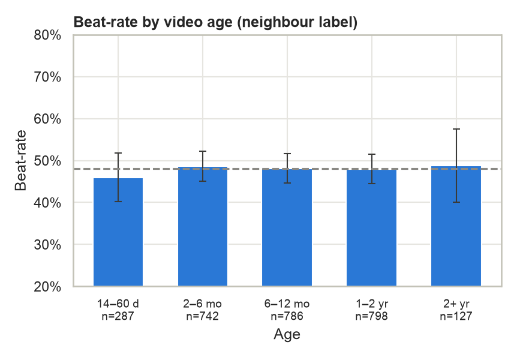
</p>

About 48% of Shorts are winners, so the two groups are nearly balanced.

**What I deliberately did not use:** likes, comments and views are never used to make predictions. They're only known *after* posting, so using them would be cheating, a problem known as data leakage.

---

# 3. Exploratory Data Analysis

<p align="center">
  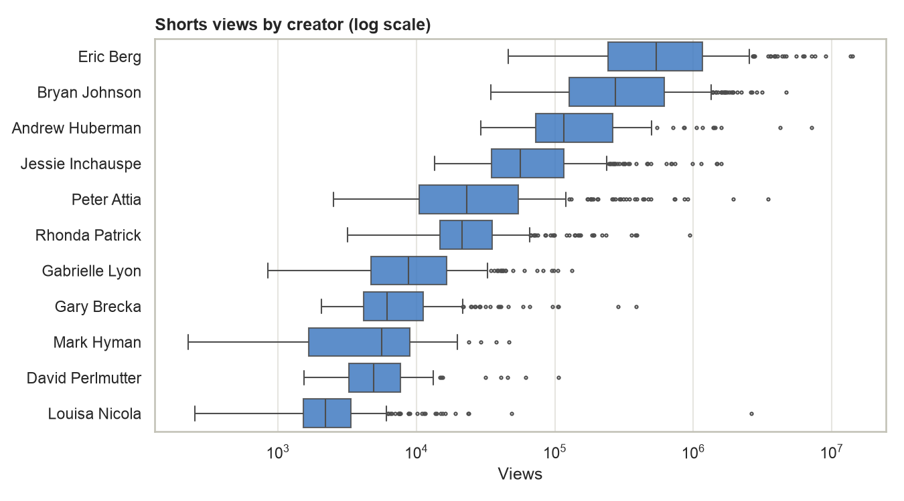
</p>

Views vary enormously, both between creators and within a single channel. This is why each Short is compared with its own channel.

### Video length matters most

<p align="center">
  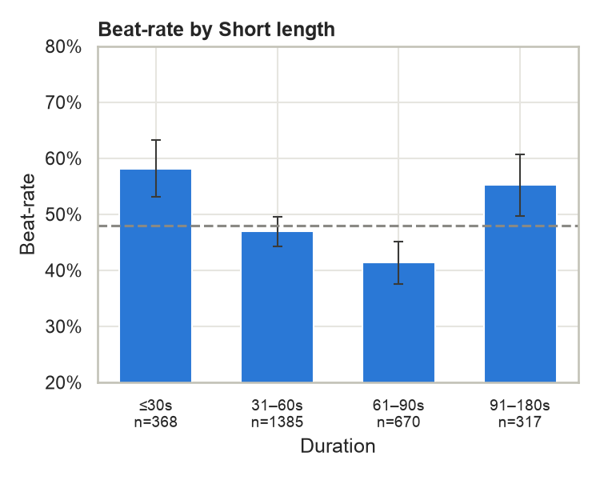
</p>

* Very short Shorts (**30 seconds or less**) win **58%** of the time.
* Shorts of **61–90 seconds** win only **41%**. This was the clearest pattern in the whole dataset.

### Title features

<p align="center">
  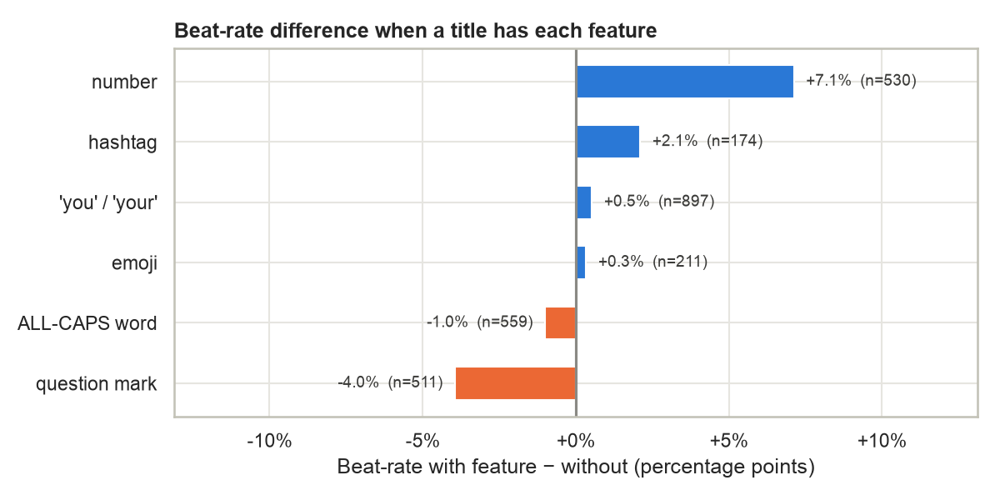
</p>

* Titles with a **number** in them win about 7 percentage points more often.
* Titles with a **question mark** do slightly worse.
* Very long titles (15+ words) do worst, but there are few of them.
* Posting **day and hour** make only a small difference: Friday and Saturday are slightly better, late night slightly worse.

**A lesson from the label fix:** with the first label, hashtags and the word "you" looked important. Both effects disappeared after the fix. They were caused by *when* those Shorts were posted, not by the titles themselves.

### Hook style, topic and hype
Each title was tagged using simple keyword rules:
* **Hook style:** question, how-to, list, warning, story or other.
* **Topic:** sleep, diet/fasting, supplements, brain, exercise, aging or other.
* **Hype words:** a count of words such as "secret", "never" and "best".

<p align="center">
  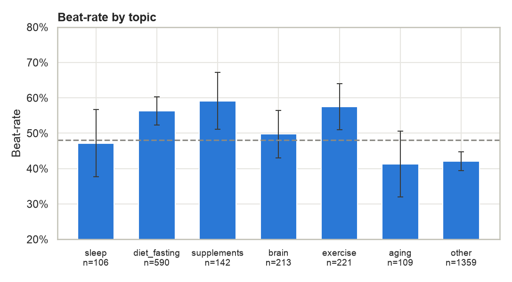
  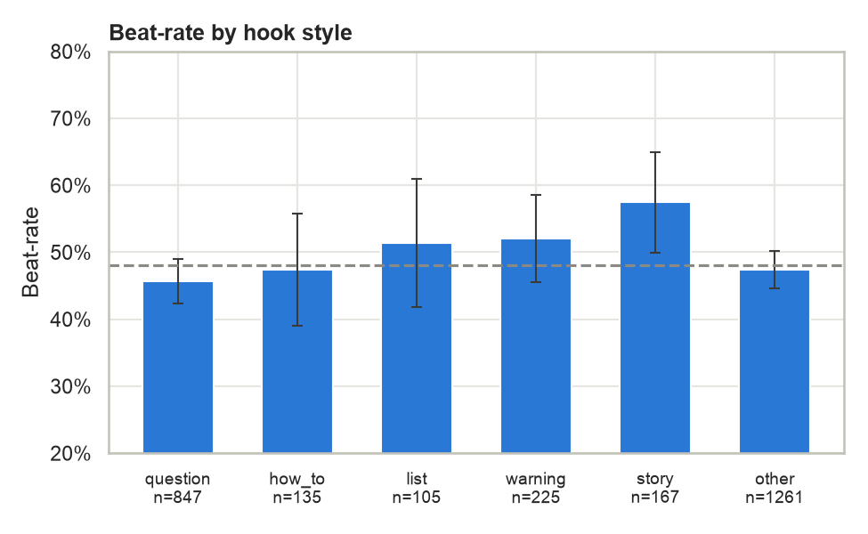
</p>

* **Practical topics win:** supplements (59%), exercise (57%) and diet/fasting (56%). **Aging (41%)** and titles with no clear topic (42%) do worst.
* **Story hooks** ("I tried…", "My…") win 57% of the time, and warnings 52%. Questions win only 46%. The differences between hook styles are small, so treat this as a tendency, not a rule.

<p align="center">
  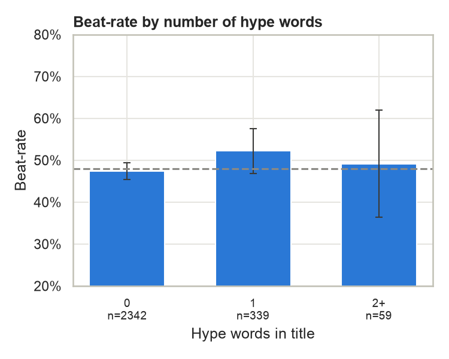
  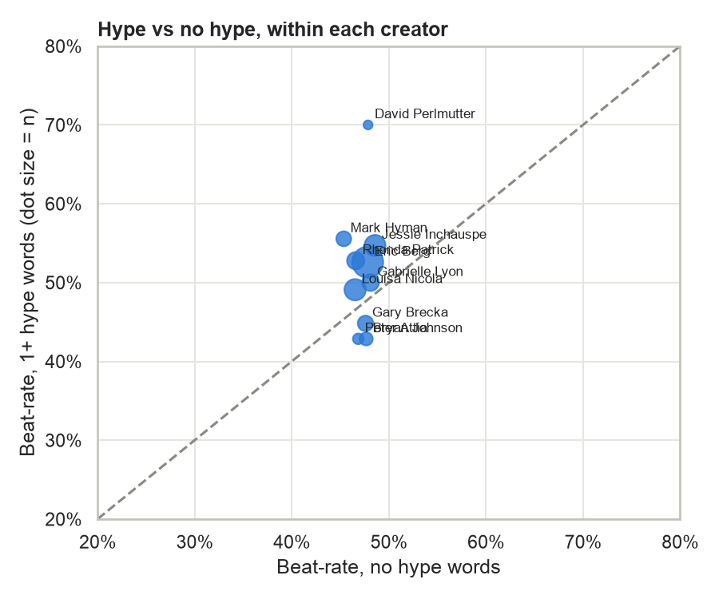
</p>

* **Does hype help?** Slightly. Titles with one hype word win 52% of the time vs 47% without, and 8 of 11 creators lean the same way. But most creators rarely use hype words, so the evidence is weak.

---

# 4. Modelling

### Features
The model uses only information available before posting:

| Group | Features |
|---|---|
| Title structure | length in characters and words; contains a question mark, number, "you", emoji, capital letters, hashtags or a person's name |
| Hook style | question / how-to / list / warning / story / other |
| Topic | sleep / diet and fasting / supplements / brain / exercise / aging / other |
| Hype | number of hype words |
| Timing and length | posting hour, weekday, video length |
| Words | TF-IDF: the 500 most useful words and word pairs in titles, with people's names removed |

### Models compared
The data was split 80% for training and 20% for testing. Models were tuned using 5-fold cross-validation, testing each setting on five different slices of the training data.

| Model | Cross-validation AUC | Test AUC |
|---|---|---|
| Baseline (always guesses "no win") | 0.50 | 0.50 |
| Logistic regression | 0.586 | 0.588 |
| **Random forest** | **0.606** | **0.603** |

The **random forest** did best. It picks the right Short from a winner/loser pair about **60% of the time**, compared with 50% for guessing. It's a real but modest result: titles and timing matter, but most of what makes a Short take off is in the video itself.

<p align="center">
  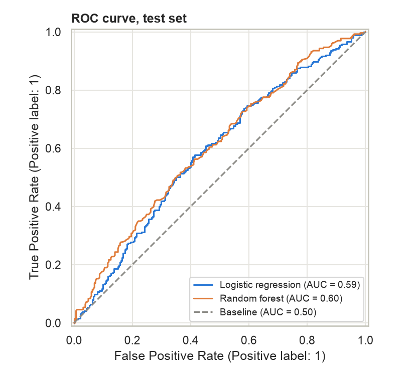
  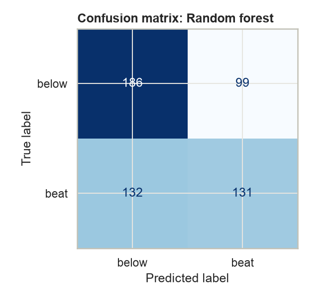
</p>

On the test set the model is right **58%** of the time. It finds about half of the real winners, and when it predicts a win it's right 57% of the time.

### Does it work for every creator?

<p align="center">
  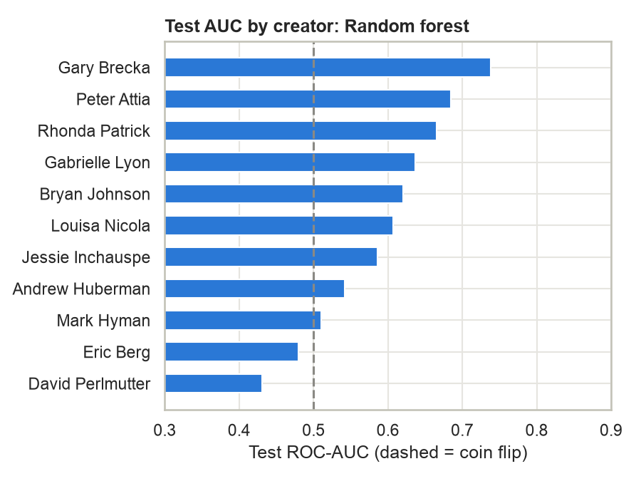
</p>

It works for 8 of 11 creators, best for Gary Brecka (0.74) and Peter Attia (0.68). It doesn't work for David Perlmutter, Eric Berg or Mark Hyman (0.43–0.51), though their test sets are small (24–59 Shorts).

### What the model relies on

<p align="center">
  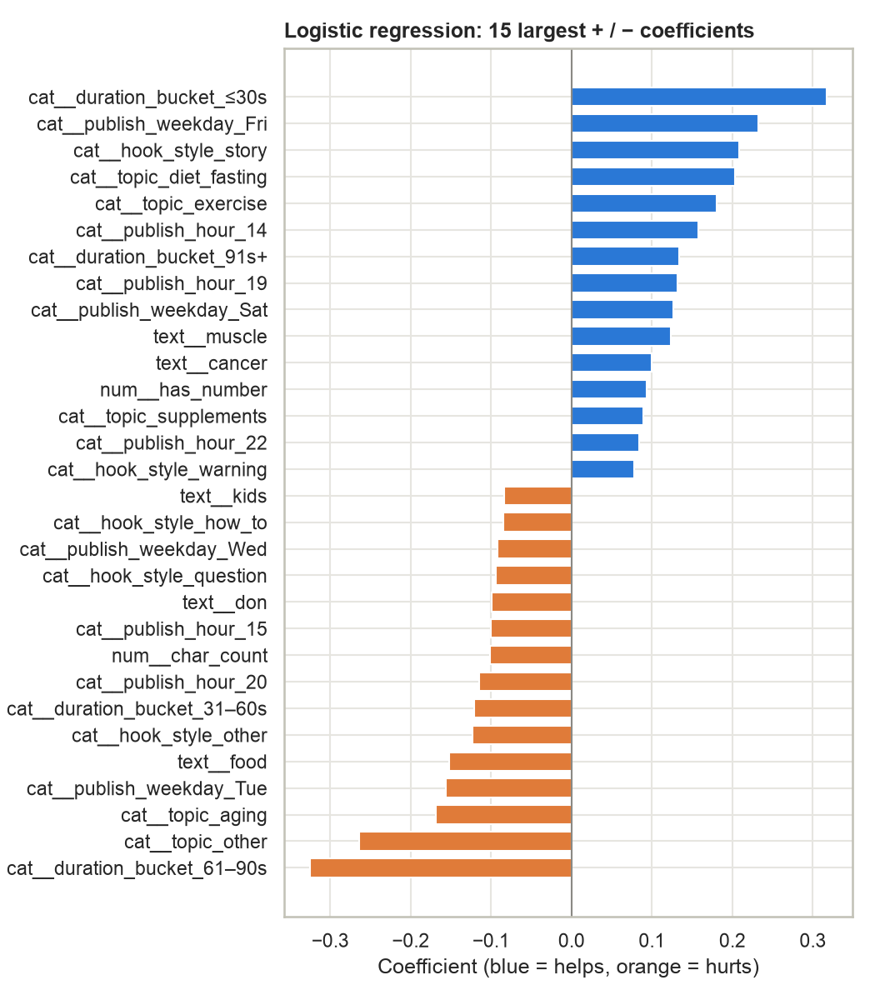
  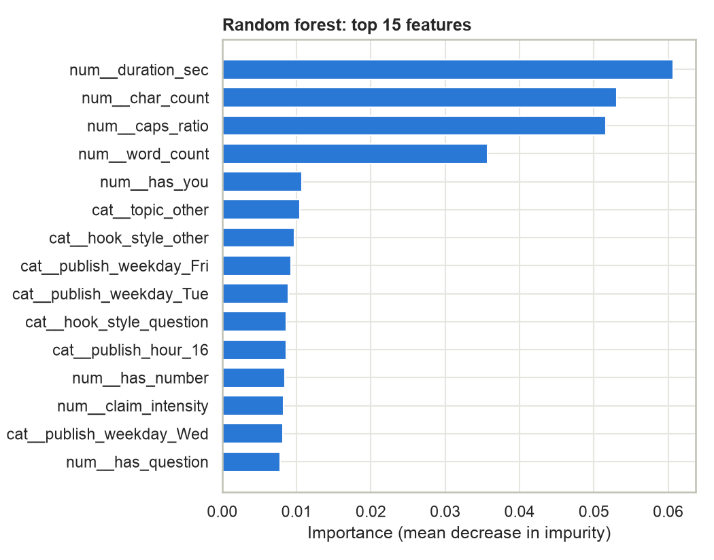
</p>

* **Video length** is the strongest signal in both models. 30 seconds or less helps, and 61–90 seconds hurts.
* The random forest also relies on **title length** and **capital letters**. This matters for Part B: an AI could "game" the model by writing longer titles in capitals.

---

# 5. Part B: AI Title Rewriter

The rewriter takes a draft title and works in four steps:

1. **Write:** asks Google Gemini for 5 rewrites, one in each hook style (question, how-to, list, warning, story).
2. **Score:** scores the draft and each rewrite with the Part A model. Video length and posting time stay the same, so only the title changes the score.
3. **Check:** rejects any rewrite that:
   * is over 70 characters,
   * uses a banned phrase ("cure", "miracle", "reverse aging", "secret", "detox"…),
   * adds hype words, numbers or capital letters,
   * changes the topic, or
   * changes the point of view, e.g. "she" becomes "I" or "you". Many titles are about a guest or a patient, not the creator.
4. **Answer:** returns the best rewrite that passed, with a short explanation. If no rewrite scores higher, it says "keep the draft".

**Example**
```
$ python codes/hook_rewriter.py "Why you wake up at 3am every night" --topic sleep

Draft : Why you wake up at 3am every night        (score 0.46)
Best  : How to stop waking up at 3am every night  (score 0.55, +0.09)
Why   : hook style: question -> how_to
# scores shift slightly with the current posting hour and weekday
```

### Results on 30 weak titles
I took the 30 lowest-scoring titles from the test set and ran them through the rewriter. To keep the test fair, these were scored with a copy of the model trained *without* the test set. The saved model has already seen them.

<p align="center">
  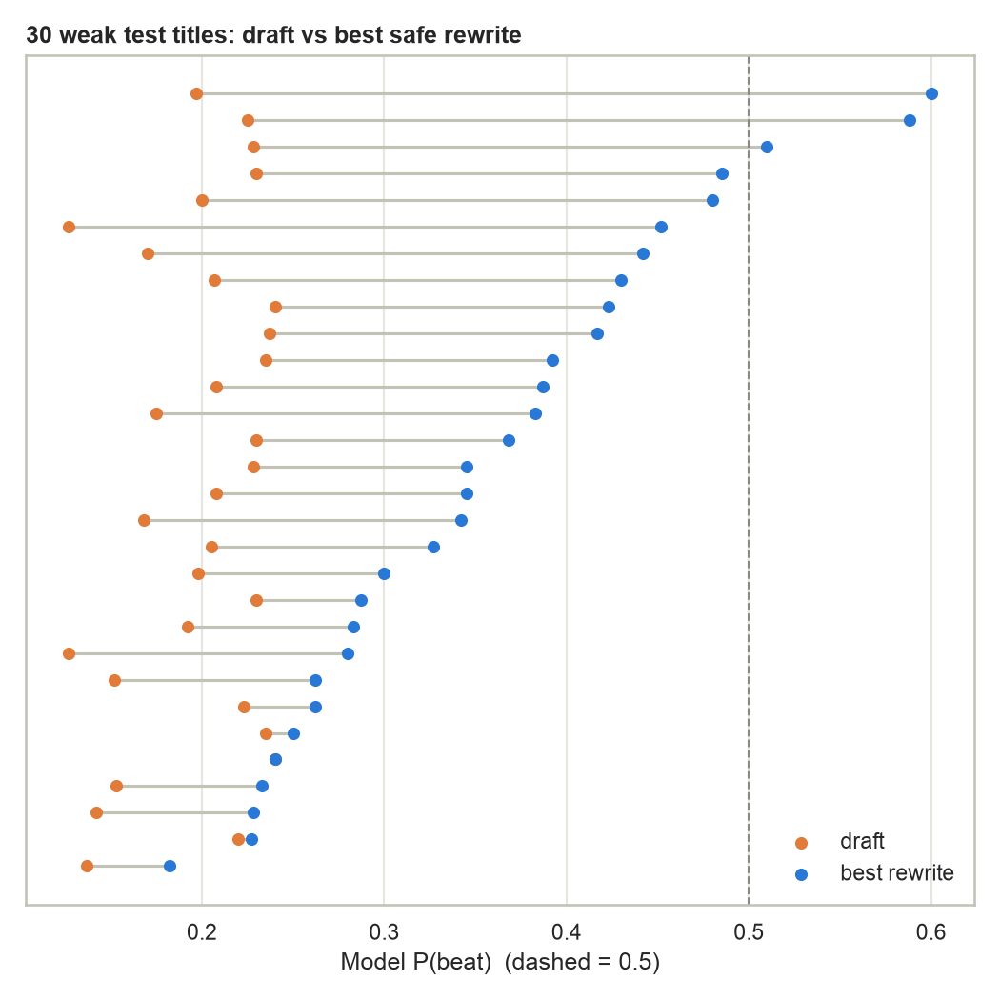
</p>

| Measure | Result |
|---|---|
| Rewrites that scored higher than the original | 29 of 30 |
| Average score, before → after | 0.20 → 0.36 |
| Rewrites that passed all safety checks | 121 of 150 |
| **Rewrites that kept the original meaning** (checked by hand) | **18 of 29 (62%)** |

I checked each rewrite by hand using a strict rule: a rewrite is "faithful" only if it adds no new claim, promise or topic, keeps the same speaker, and a viewer would expect the same video. When in doubt, it was marked no.

### The key finding: fixing a change-of-speaker problem
The first version of the rewriter doubled the scores, but **only 10 of 29 rewrites (34%) kept the original meaning.** The most common problem was a **change of speaker**. Many of these channels post clips about guests or other people, but the AI rewrote them as if the creator were talking about themselves:

| Original | First-version rewrite | Problem |
|---|---|---|
| She Was Healing Others While Destroying Herself | I was healing others while destroying myself | "She" became "I" |
| AI in Medicine: The Top Two Priorities \| (guest) | My top two priorities for AI in medicine | A guest's ideas became "mine" |
| Reducing Digital Dependency in Youth | I helped my kids reduce their screen time | Invents a personal story |

**The fix:** the prompt now tells the AI to keep the original point of view, and a new automatic check rejects any rewrite that adds a person the original doesn't have (I/we, you, she/he) or drops the person it's about. An in-between version that only blocked "I"/"my" wasn't enough: the AI simply switched to "you" ("Stop destroying yourself…") or invented a "her".

| | First version | After the fix |
|---|---|---|
| Rewrites that kept the original meaning | 10 of 29 (34%) | **18 of 29 (62%)** |
| Average score increase | +0.22 | +0.16 |

Faithfulness almost doubled. The scores rose a little less, because some of the highest-scoring rewrites were the ones that changed the speaker. That's the trade-off between a higher score and an honest title.

**Remaining problems** are about meaning, which simple rules can't catch. For example, warning hooks that invent a cause ("Bladder Damage" → "Stop doing this before it causes bladder damage") or make a claim stronger ("could cause" → "is causing"). This is why every AI rewrite still needs a human check. A higher model score is also not the same as more real views. The model is right only 60% of the time, so any rewrite should be tested on a real channel, for example with YouTube's title A/B testing.

---

# 6. Conclusion

### Recommendations for health creators
1. **Keep Shorts short.** 30 seconds or less wins most often.
2. **Lead with a concrete, practical topic** such as supplements, exercise or food, rather than general "aging" or "longevity".
3. **Try personal story or warning hooks** instead of plain questions.
4. **Skip the hype.** The gain is tiny, and misleading health claims damage trust.
5. **Use AI title tools carefully.** They can raise a score while quietly changing the meaning, so always check the result and A/B test it.

### Limitations
* View counts are a single snapshot in time.
* Thumbnails and the video content itself are not included.
* Results apply only to these 11 channels, which contribute unequal numbers of Shorts (89–300).
* Two creators are represented by their clips channels.
* Hook style, topic and hype are tagged with simple keyword rules.

### Future work
* Add the first 3 seconds of each video's transcript, and thumbnail features.
* Test the model on creators it has never seen (GroupKFold).
* Track views over time instead of a single snapshot.
* Improve the rewriter: add an automatic meaning check (e.g. a second AI model that compares the original and the rewrite) to catch invented causes and stronger claims.

---

# Repository Structure

```
05_Capstone-Hook-Lab/
├── README.md
├── requirements.txt
├── .env.example              # template for API keys
├── codes/
│   ├── 01_collect_clean.ipynb
│   ├── 02_eda.ipynb
│   ├── 03_model.ipynb
│   ├── 04_rewriter_demo.ipynb
│   ├── collect.py            # YouTube API helpers
│   ├── features.py           # feature rules (shared by notebooks 03 and 04)
│   └── hook_rewriter.py      # Part B command-line tool
├── data/
│   ├── channels.csv          # the 11 channels
│   ├── shorts.csv            # cleaned data, one row per Short
│   ├── eval_rewrites.csv     # Part B results with the hand check (final version)
│   ├── eval_rewrites_v1.csv  # first-version results, for the before/after comparison
│   └── gemini_cache.json     # saved Gemini replies (re-runs need no API calls)
├── images/                   # charts used in this README
└── models/
    └── hook_model.joblib     # the trained random forest
```

# How to Run

```bash
python -m venv .venv && source .venv/bin/activate
pip install -r requirements.txt
cp .env.example .env    # add your YOUTUBE_API_KEY and GEMINI_API_KEY
```

Run the notebooks in `codes/` in order (01 → 04). Notebook 01 needs the raw API data in `data/raw/`, which isn't included in the repo. To start from the cleaned data, begin at notebook 02. Notebook 04 uses the saved Gemini replies, so it needs no API key unless you rewrite new titles.

**Libraries:** Python 3.13, pandas, NumPy, scikit-learn, matplotlib, seaborn, requests, python-dotenv, joblib, google-genai.
